# Orders API ? AWS Lambda y API Gateway

Taller Java 17 / Maven / JUnit. El proyecto Maven se encuentra en la ra?z de este repositorio.

## Contrato dise?ado antes del c?digo

El recurso es un pedido (`Order`); `/orders` representa la colecci?n. `/orders/{id}` identifica un miembro mediante su identificador estable. `customerId` es un filtro de b?squeda de la colecci?n, por eso es query parameter.

| M?todo | URL | Entrada | ?xito | Errores |
|---|---|---|---|---|
| POST | `/orders` | JSON customerId, product, quantity | 201, pedido creado y Location | 400, 500 |
| GET | `/orders/{id}` | id en path | 200, pedido | 400, 404, 500 |
| GET | `/orders?customerId=CUST-42` | customerId requerido | 200, lista (puede ser []) | 400, 500 |
| DELETE | `/orders/{id}` | id en path | 204, cuerpo vac?o | 400, 404, 500 |

Ejemplo de entrada: `{"customerId":"CUST-42","product":"MacBook Air","quantity":1}`.
Salida POST: los mismos datos m?s `id: "ORD-<UUID>"`. El id lo genera el servidor. POST no devuelve 204 porque entrega el recurso creado. `Location: /orders/{id}` permite localizarlo.

Errores consistentes: `{"error":"ORDER_NOT_FOUND","message":"Order ORD-999 does not exist"}`. `error` es un c?digo estable para clientes; `message` explica el problema sin exponer stack traces. Validaci?n: strings no vac?os y cantidad entera positiva; campos desconocidos o JSON mal formado se rechazan. Una b?squeda sin coincidencias devuelve 200 y `[]`, no 404. El proxy a?ade 405 y Allow para m?todos no soportados que lleguen al handler. Gateway puede rechazar rutas/m?todos antes de invocarlo con su propio 4xx.

## Arquitectura

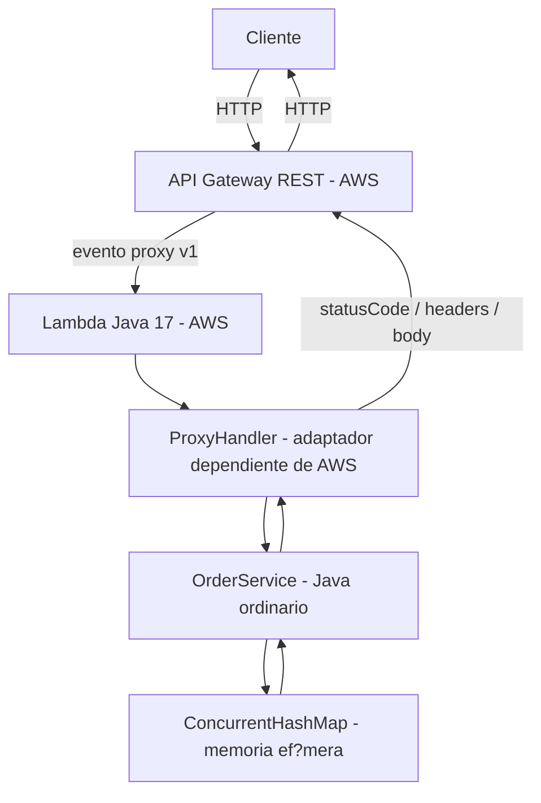

Alternativa custom, desplegada en otra API:

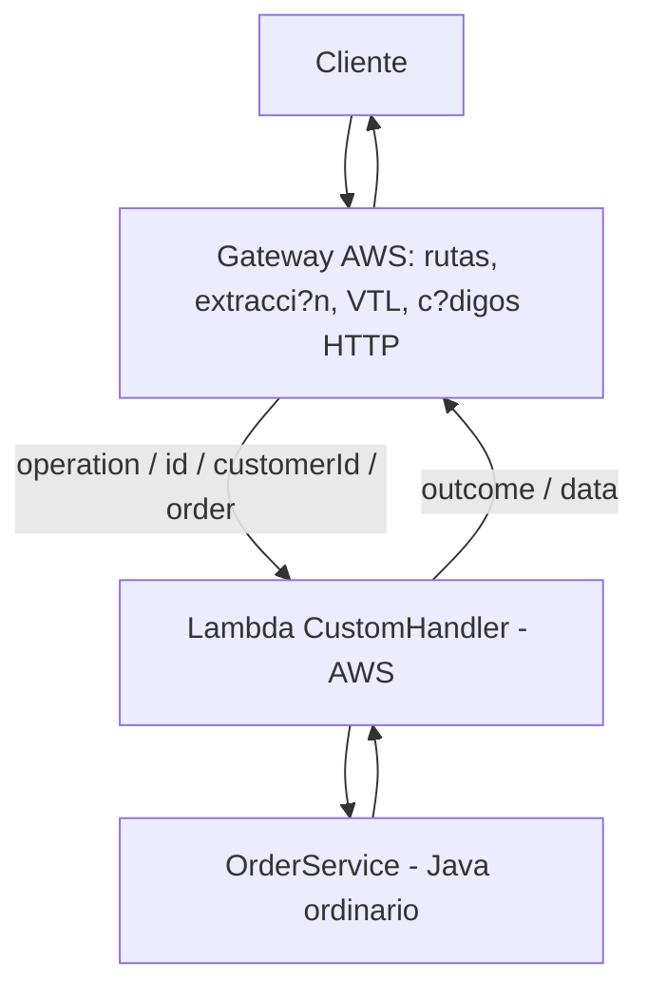

Invocaci?n directa de la parte II:

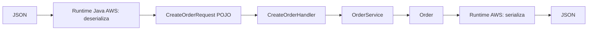

`OrderService`, `Order`, `CreateOrderRequest` y la excepci?n no importan AWS ni conocen HTTP. No se necesita Spring Boot ni un servidor web. Se prueban mediante llamadas Java. El JAR sombreado contiene clases y dependencias de ejecuci?n; JUnit no forma parte del artefacto de producci?n.

**Memoria:** cada entorno Lambda tiene su propio mapa. Se precargan ORD-42/CUST-42 y ORD-100/CUST-100. POST y DELETE solamente afectan al entorno que atiende esa invocaci?n. Las tres Lambdas y las dos APIs no comparten estado; un cold start restaura los datos iniciales. Ni siquiera con peticiones consecutivas se garantiza leer un pedido reci?n creado. Esto es una limitaci?n expl?cita del taller, no almacenamiento persistente; un sistema real usar?a, por ejemplo, DynamoDB. El script HTTP usa pedidos iniciales para GET y DELETE y no presupone que un POST est? disponible en otra invocaci?n.

## Construccion y pruebas

Requisitos: JDK 17 o superior, Maven 3.9 y acceso inicial a Maven Central. Ejecutar desde la raiz del repositorio:

```powershell
mvn test
mvn package
jar tf target/orders-api.jar
```

## Despliegue reproducible

Requisitos: AWS CLI, SAM CLI, credenciales y region configuradas, y permisos CloudFormation, IAM, Lambda, API Gateway y S3. El despliegue crea recursos facturables.

```powershell
mvn package
sam validate --lint --template-file infra/template.json
sam deploy --template-file infra/template.json --stack-name orders-workshop --resolve-s3 --capabilities CAPABILITY_IAM --region us-east-1
aws cloudformation describe-stacks --stack-name orders-workshop --region us-east-1 --query "Stacks[0].Outputs"
```

No hace falta `sam build`: CodeUri apunta al JAR empaquetado. Las salidas del stack son `ProxyUrl`, `CustomUrl` y `DirectFunctionName`.

Para invocar Lambda directamente, reemplazar `NOMBRE` por el valor de `DirectFunctionName`:

```powershell
aws lambda invoke --function-name NOMBRE --region us-east-1 --cli-binary-format raw-in-base64-out --payload file://examples/create.json target/direct-first.json
aws lambda invoke --function-name NOMBRE --region us-east-1 --cli-binary-format raw-in-base64-out --payload file://examples/create-second.json target/direct-second.json
Get-Content target/direct-first.json
Get-Content target/direct-second.json
```

Ambas respuestas deben conservar customerId, product y quantity y generar identificadores distintos.

Para eliminar el stack:

```powershell
aws cloudformation delete-stack --stack-name orders-workshop --region us-east-1
```

El bucket de artefactos de SAM y los grupos de logs pueden permanecer despues de eliminar el stack.

## Pruebas locales e infraestructura

Los tests cubren el servicio, creacion, busqueda, validacion, errores, borrado repetido, ciclo proxy completo, Location, JSON invalido, 204 vacio, fallo inesperado y handlers custom/directo. Las pruebas Java no verifican las plantillas VTL ejecutadas por AWS.

`infra/template.json` define dos REST APIs (evento proxy v1), tres Lambdas, roles basicos de logs y permisos de invocacion limitados a cada API. Incluye las cuatro operaciones en ambas arquitecturas. CodeUri apunta al JAR empaquetado. Los handlers son `edu.eci.orders.lambda.ProxyHandler::handleRequest`, `edu.eci.orders.lambda.CustomHandler::handleRequest` y `edu.eci.orders.lambda.CreateOrderHandler::handleRequest`.

`.mvn/maven.config` ubica la cache en `.m2/repository` dentro del proyecto. La cache y target estan ignorados por Git.

El runtime administrado convierte el JSON al tipo declarado por `RequestHandler`. `CreateOrderRequest` tiene constructor vac?o y getters/setters; la salida es un objeto Java que el runtime serializa. En proxy el runtime deserializa el sobre API Gateway, mientras Jackson en nuestro adaptador procesa el **body**, que es un string JSON dentro del evento. No son la misma etapa. Referencia: [AWS Lambda Java serialization](https://docs.aws.amazon.com/lambda/latest/dg/java-custom-serialization.html).

## Mapping custom

Gateway construye `operation`, extrae `id` del path y `customerId` del query; POST inserta el JSON en `order`. Las cadenas se escapan con `escapeJavaScript` y correcci?n de ap?strofes para JSON. El handler devuelve `outcome` y `data`, sin c?digos HTTP. VTL convierte OK/CREATED/DELETED/INVALID/NOT_FOUND/ERROR en 200/201/204/400/404/500, extrae data y a?ade Location al crear. La respuesta de fallo de ejecuci?n Lambda se mapea a 500. Gateway tambi?n configura cuerpos JSON para errores propios; un JSON rechazado antes de Lambda puede usar INVALID_REQUEST en lugar de INVALID_INPUT.

La variante custom valida en Gateway el esquema del body POST y la presencia de customerId; el servicio valida tambi?n el contenido. Las plantillas y las respuestas de m?todo est?n incluidas en OpenAPI dentro de SAM. Cada operaci?n define integraci?n `aws` (custom) o `aws_proxy`. V?ase [respuestas de integraci?n AWS](https://docs.aws.amazon.com/apigateway/latest/developerguide/api-gateway-integration-settings-integration-response.html).

## Evento proxy

`examples/proxy-event.json` muestra `httpMethod`, `path`, `resource`, `pathParameters`, `queryStringParameters`, `headers`, `body` e `isBase64Encoded`. El router usa `resource`, la plantilla de ruta estable provista por REST API; `path` es la URL concreta. El adaptador extrae par?metros, decodifica base64 cuando corresponde, deserializa el body, invoca el servicio y construye statusCode, headers y body serializado. Ver [integraci?n API Gateway con Lambda](https://docs.aws.amazon.com/lambda/latest/dg/services-apigateway.html).

## Pruebas HTTP

Ejecutar el script una vez contra `ProxyUrl` y otra contra `CustomUrl`, usando las salidas del stack:

```powershell
./scripts/smoke.ps1 -BaseUrl 'URL_DE_LA_API'
```

Para inspeccionar respuestas y cabeceras manualmente:

```powershell
$BASE = 'URL_DE_LA_API'
curl.exe -i "$BASE/orders/ORD-42"
curl.exe -i "$BASE/orders?customerId=CUST-42"
curl.exe -i "$BASE/orders?customerId=CUST-100"
curl.exe -i -X POST "$BASE/orders" -H "Content-Type: application/json" --data-binary '@examples/create.json'
curl.exe -i "$BASE/orders/ORD-999"
curl.exe -i -X POST "$BASE/orders" -H "Content-Type: application/json" --data '{}'
curl.exe -i -X DELETE "$BASE/orders/ORD-42"
```

## Evidencias de ejecución

Las siguientes capturas documentan la ejecución del taller del 27 de octubre de 2026, en el orden del flujo de trabajo: pruebas locales, empaquetado, despliegue y verificación en AWS.

### 1. Pruebas unitarias

`mvn test` finaliza con `BUILD SUCCESS`: se ejecutan 11 pruebas, sin fallos, errores ni pruebas omitidas.

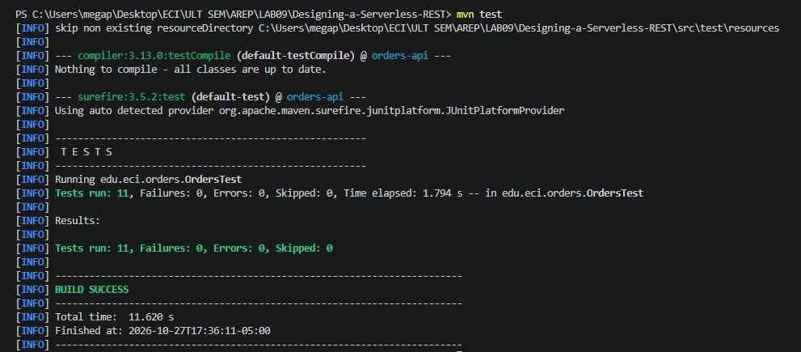

### 2. Empaquetado de la aplicación

`mvn package` termina con `BUILD SUCCESS` y reemplaza el artefacto original por el JAR sombreado que incluye las dependencias. Las advertencias de archivos duplicados no impidieron generar el paquete.

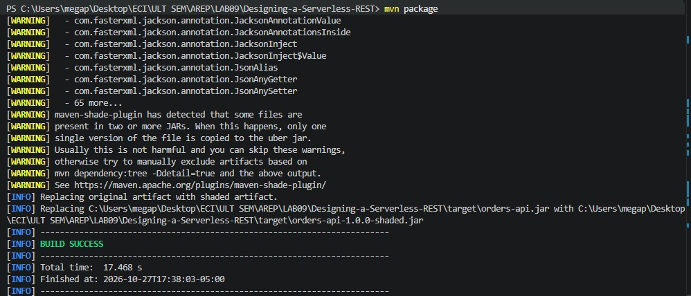

### 3. Verificación del artefacto

`Get-Item` confirma que existe `target/orders-api.jar`, con un tamaño de 3.420.335 bytes, listo para el despliegue de las funciones Lambda.

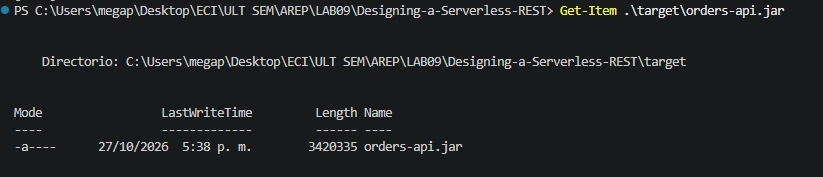

### 4. Stack y salidas de CloudFormation

El stack `orders-workshop` aparece en estado `UPDATE_COMPLETE`. Sus salidas muestran `CustomUrl`, `ProxyUrl` y `DirectFunctionName`, utilizados para las pruebas HTTP y la invocación directa.

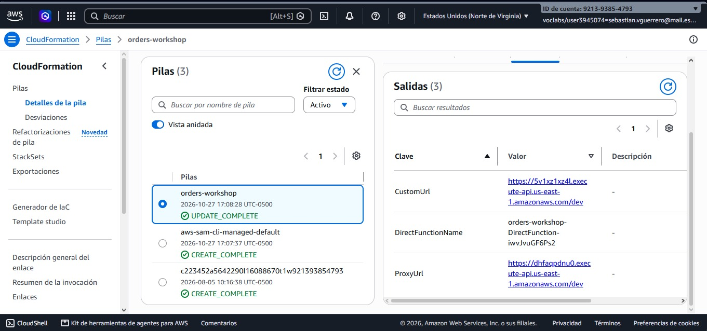

### 5. Funciones Lambda desplegadas

La consola de AWS muestra las tres funciones del stack: `CustomFunction`, `DirectFunction` y `ProxyFunction`. Todas utilizan el runtime Java 17 y un paquete de tipo ZIP.

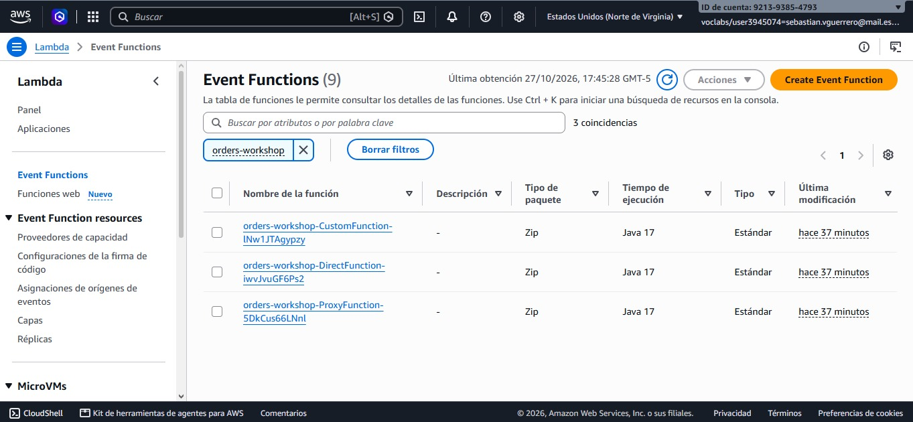

### 6. Primera invocación directa

Se invoca `DirectFunction` mediante AWS CLI con `examples/create.json` y se guarda la respuesta en `target/direct-first.json`. La invocación devuelve `StatusCode: 200`, confirmando que la llamada a Lambda se completó; este estado corresponde a la invocación y no a una respuesta HTTP de API Gateway.

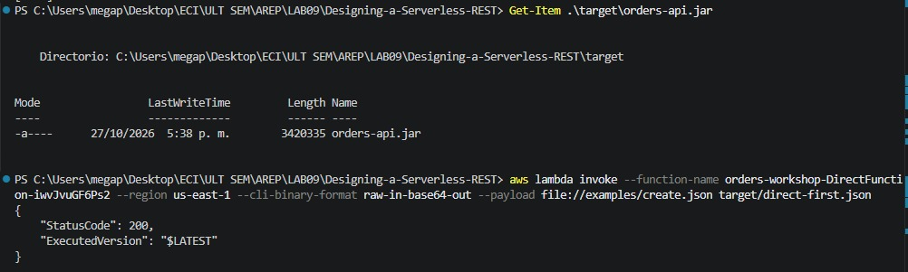

### 7. Segunda invocación y resultados serializados

Se realiza otra invocación con `examples/create-second.json`. Al consultar ambos archivos de salida se observan pedidos con identificadores distintos, conservando los datos enviados: un MacBook Air para `CUST-42` y dos monitores para `CUST-100`.

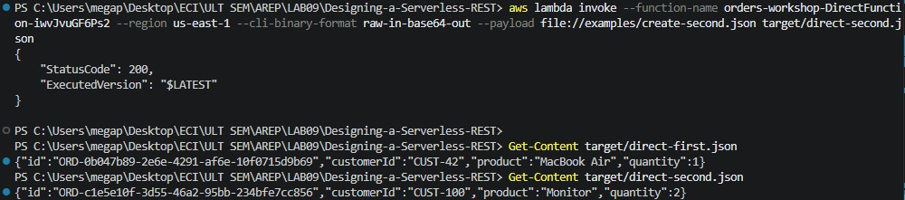

### 8. Pruebas HTTP de la API proxy

El script `smoke.ps1` contra la API proxy obtiene 201 al crear, 200 en las consultas, 404 para un pedido inexistente, 400 ante una entrada inválida y 204 al eliminar. La validación de la entrada inválida devuelve `INVALID_INPUT` desde la aplicación.

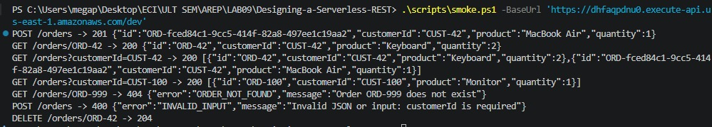

### 9. Pruebas HTTP de la API custom

El mismo script contra la API custom verifica los códigos 201, 200, 404, 400 y 204. El mapping transforma correctamente los resultados de Lambda en respuestas HTTP; el POST inválido es rechazado por API Gateway con `INVALID_REQUEST`. La captura confirma que la creación ya devuelve 201 y que la eliminación devuelve 204 sin cuerpo.

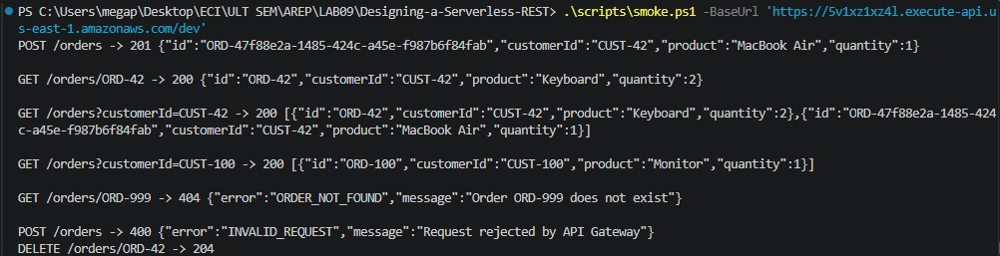

## Cobertura HTTP

El script `scripts/smoke.ps1` comprueba 201, Location, 200, dos busquedas, 404, 400 y 204 vacio. Un GET posterior a DELETE en AWS puede atenderlo otro entorno; las pruebas locales verifican esa secuencia sobre un servicio compartido.

## Comparaci?n arquitect?nica y checkpoints

| Pregunta | Custom | Proxy |
|---|---|---|
| M?s configuraci?n Gateway | S?: VTL por operaci?n y mappings de respuesta | Rutas e integraci?n proxy |
| M?s c?digo Java de infraestructura | Dispatch y resultado neutral | Evento AWS, parsing JSON y respuestas HTTP |
| Pruebas locales | Servicio y handler; VTL exige pruebas en Gateway | Servicio y contrato del adaptador verificables con JUnit |
| D?nde se decide status | Gateway transforma outcome | ProxyHandler |
| Crecimiento de 3 a 30 operaciones | Multiplica mappings y riesgo de divergencia | Crece el routing; convendr?a separar adaptadores por recurso |
| Limpieza de l?gica de negocio | Java puro | Java puro, con separaci?n expl?cita |
| Comprensi?n por otro desarrollador | Necesita leer Java y VTL | El flujo HTTP est? concentrado en Java |

Gateway custom centraliza routing, extracci?n, transformaci?n de entradas y salidas, c?digos y errores. Permite reutilizar funciones ajenas a HTTP y adaptar clientes sin modificar el servicio. A cambio aumenta configuraci?n espec?fica de AWS, complejidad de escapes y dificultad de pruebas locales. Proxy mueve esas responsabilidades al adaptador, a?ade dependencia AWS en esa capa y facilita depuraci?n/pruebas. Para un sistema mayor elegir?a proxy con adaptadores organizados, almacenamiento persistente y contratos automatizados; custom es razonable para transformaciones controladas por un equipo de infraestructura. Ninguna alternativa obliga a contaminar el dominio con HTTP.

Checkpoint 1: Java funciona sin AWS, sin web server y sin Spring; solo los adaptadores conocen infraestructura. Checkpoint 2: el diagrama de serializaci?n muestra el recorrido real propuesto. Checkpoint 3: la distribuci?n de responsabilidades y sus compromisos se detallan arriba. Un error inesperado en la aplicaci?n devuelve 500 gen?rico y registra detalle en logs; fallos de plataforma pueden producir 5xx de Gateway sin ejecutar Java.

## Cr?tica de decisiones del agente


1. **Una Lambda por arquitectura, no una por ruta.** El agente busca compartir servicio y simplificar despliegue. Es adecuado para cuatro operaciones peque?as; la alternativa ofrece permisos y escalado por operaci?n, con m?s funciones y estado a?n m?s fragmentado. Se implementaron dos variantes independientes y una funci?n directa educativa.
2. **Validaci?n en OrderService.** Evita aceptar pedidos inv?lidos por invocaci?n directa. Se acepta; validar solo en Gateway dejar?a otros accesos sin protecci?n. El adaptador adem?s comprueba formato JSON, porque esa responsabilidad pertenece al transporte.
3. **Resultado neutral en custom y HTTP en proxy.** Mantiene c?digos fuera del dominio y permite comparar d?nde residen. Alternativa: lanzar excepciones con regex por error en Gateway. Se prefirieron outcomes expl?citos y un mapping 500 para fallos Lambda, evitando usar excepciones para resultados esperados.
4. **Mapa concurrente precargado.** Simplifica el taller y reproduce b?squedas sin base de datos. Se acepta ?nicamente como demostraci?n ef?mera. La alternativa DynamoDB resuelve persistencia y concurrencia entre instancias; queda fuera del alcance inicial y ser?a necesaria para producci?n.

## Extensi?n DELETE y comparaci?n con la predicci?n

La propuesta previa est? en `docs/delete-prediction.md`, confirmada en Git antes de la implementaci?n (commit cfd44a5). El resultado coincide: cambian servicio, routing proxy, dispatch custom y ambas APIs; no se a?ade funci?n. El servicio elimina at?micamente mediante ConcurrentHashMap.remove; excepci?n de ausencia se transforma en 404 y ?xito en 204 sin JSON. Los tests verifican borrado y ausencia posterior sobre el mismo estado. La prediccion guardada esta atribuida al agente.
